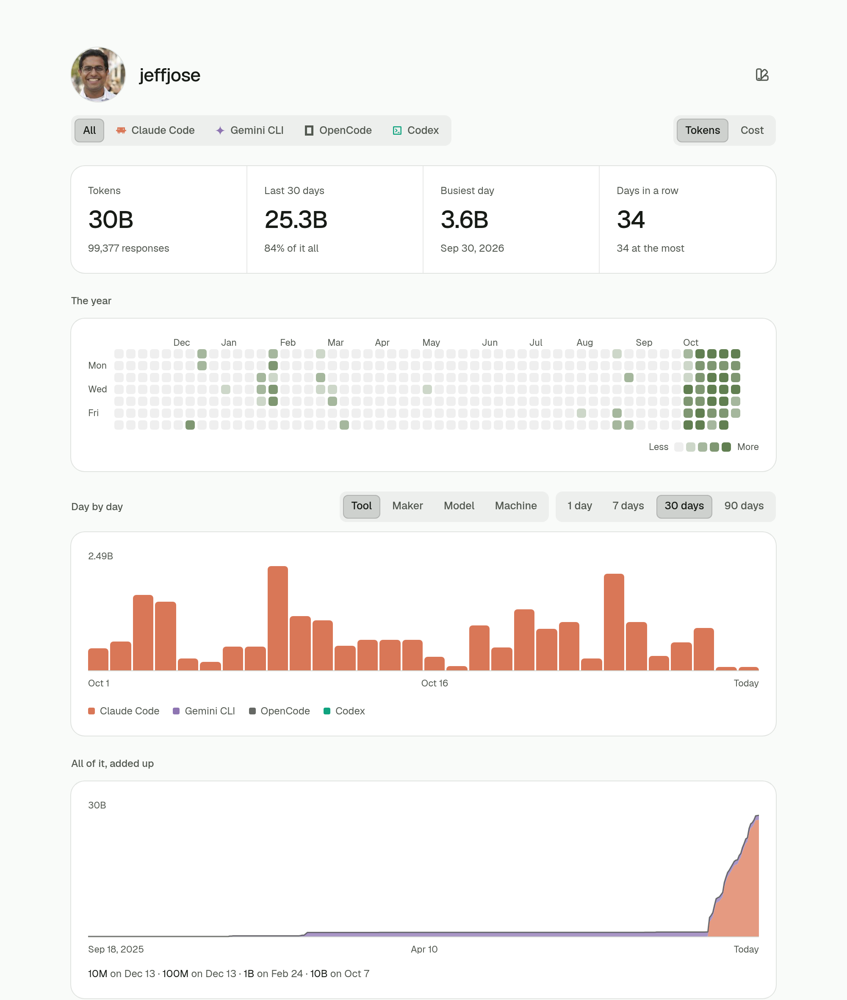

# tokendash

What you have spent on Claude Code, Codex, OpenCode, Gemini CLI and more, on a
page that is yours: `/<github-username>`.



```sh
pnpm install
pnpm collect <you>   # count this machine
pnpm dev             # http://localhost:5173/<you>
```

Only counts leave your machine: no paths, no project names, no words. How it
looks and why is in [DESIGN.md](DESIGN.md).
